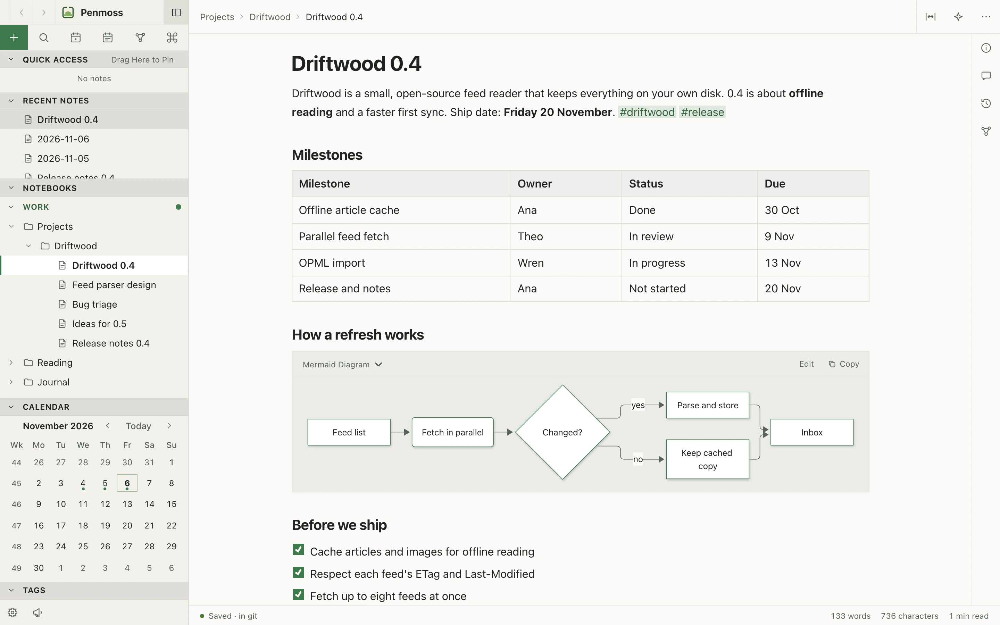

# Penmoss

**Your git. Your agents. Your notes.** Penmoss is a free, open source notes app for Mac and Android. Your notes are markdown files in a private git repository you choose, and AI agents such as Claude Code, Codex and OpenCode can read and edit them through a local MCP server or the `penmoss` CLI. There is no Penmoss server, no account and no subscription.



## Download

- **Mac** (macOS 12 or later): [Penmoss.dmg](https://github.com/htxryan/penmoss/releases/latest/download/Penmoss.dmg). See [Install on Mac](https://penmoss.app/docs/install/mac/).
- **Android** (Android 17 or later): [Penmoss.apk](https://github.com/htxryan/penmoss/releases/latest/download/Penmoss.apk), sideloaded. See [Install on Android](https://penmoss.app/docs/install/android/).

Every build from `main` is also published as an Alpha prerelease on [Releases](https://github.com/htxryan/penmoss/releases).

## Docs

How to use Penmoss is at **[penmoss.app/docs](https://penmoss.app/docs/)**: your first notebook, the editor, the apps, connecting an agent, and the CLI and MCP reference. The pages are written in [`site/src/content/docs/docs/`](site/src/content/docs/docs/), so a fix is a pull request away.

## Build from source

Prerequisites: Node 24 (see `.node-version`), [Task](https://taskfile.dev) 3, and pnpm through Corepack:

```sh
corepack enable pnpm   # the pnpm version is pinned by packageManager in package.json
task setup             # pnpm install
task dev               # the Mac app from this checkout
```

| Command              | What it does                                                                                        |
| -------------------- | --------------------------------------------------------------------------------------------------- |
| `task check:changed` | Lint and format the changed files; typecheck and unit-test the changed packages; before each commit |
| `task check`         | Lint (ESLint + Prettier), typecheck and unit tests for every package; before pushing                |
| `task test -- core`  | One package's unit tests (`core`, `editor`, `git-notebook`, `sync-client`, `cli`, `web`, `relay`)   |
| `task e2e`           | Playwright web suite on git notebooks; `task e2e -- smoke.spec.ts` for one spec                     |
| `task site:dev`      | penmoss.app and its docs, with live reload                                                          |
| `task --list`        | All commands, including the Mac and Android apps                                                    |

The Mac app is in [`docs/desktop.md`](docs/desktop.md), Android in [`docs/android.md`](docs/android.md), the CLI in [`docs/cli.md`](docs/cli.md), the relay in [`docs/relay.md`](docs/relay.md), and the site in [`site/README.md`](site/README.md).

```
apps/web/              React app (Vite), loaded by the Mac app
apps/desktop/          Mac app (Electron main process)
apps/android/          Android app (Kotlin, Compose)
apps/relay/            The relay: claude.ai to git notebooks over remote MCP (Cloudflare Worker)
packages/core/         Schema, markdown codec, IDs, periodic notes (pure functions)
packages/editor/       TipTap extensions
packages/git-notebook/ The git-notebook engine, local MCP server and transports
packages/sync-client/  Yjs documents, IndexedDB replica, attachments, local search index
packages/ui/           Shared React components and themes
packages/cli/          penmoss CLI
site/                  penmoss.app: the brochure and the user docs
```

How the code fits together is in [`docs/architecture.md`](docs/architecture.md), the decisions in [`docs/decisions.md`](docs/decisions.md), and how work is planned and checked in [`docs/development.md`](docs/development.md). The roadmap is the open [GitHub issues](https://github.com/htxryan/penmoss/issues). To contribute, read [CONTRIBUTING.md](CONTRIBUTING.md), the [Code of Conduct](CODE_OF_CONDUCT.md) and the [Security policy](SECURITY.md).

CI's tests run on GitHub's hosted runners; the performance budgets and the signed builds run on the maintainer's own Macs ([`docs/ci.md`](docs/ci.md)). A pull request from a fork runs the hosted jobs once a maintainer approves the run; see [CONTRIBUTING](CONTRIBUTING.md).

## License

[MIT](LICENSE), © 2026 Ryan Henderson.
