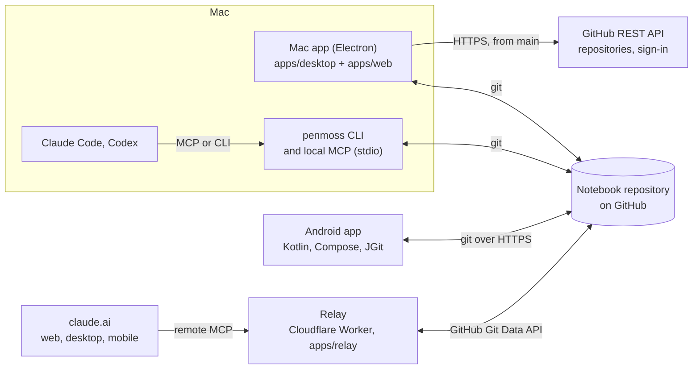

# Architecture

Penmoss as it is built today: git notebooks only, with no server and no account (D48, D49). The decisions behind each piece are in [`decisions.md`](decisions.md). The history of how it got here is in the closed GitHub issues and in [`evidence/`](evidence/).

## Product

A personal notes app Ryan fully owns: Notion-level polish on plain markdown documents, offline-first on Mac and Android, and directly readable and writable by AI agents through MCP and a CLI.

- **Problem.** Obsidian is powerful but finicky. Apple Notes is convenient but has poor editing and no customisation. Notion feels good but costs money, and the data is not yours. None of them let AI agents work on the notes safely.
- **User.** Ryan, on a MacBook and a Pixel 10 Pro.
- **What success means.**
  - No data loss: every edit made on any device, online or offline, reaches every device after sync and stays recoverable from history.
  - Agents edit notes without clobbering concurrent typing, and every agent edit is attributed and revertible.
  - Every note is readable as plain markdown in its repository.
  - Long-form writing on the Pixel works without editor-caused errors.

### In scope

- A rich editor: headings, lists, checklists, quotes, code with highlighting, images, tables, callouts, toggles, Mermaid, math, attachments, Excalidraw drawings and note embeds; a slash menu, markdown shortcuts and a drag handle.
- Copy and paste as markdown and rich text, paste-and-match-style, pasted images.
- Nested folders with manual, A–Z and modified sorting; tags; wikilinks, backlinks and the graph.
- Daily and weekly notes, templates, the calendar and quick capture.
- The recent-notes switcher, the command palette, and every action bound to a customisable shortcut.
- Search by words everywhere, and by meaning on the Mac (the app and agents' `penmoss`), with EmbeddingGemma running on the Mac (D59). The relay and Android search by words.
- Offline-first sync with CRDT merging, attributed version history and Trash.
- MCP server and CLI with full read and write.
- Themes with light, dark and system modes, and a theme editor.

### Requirements every change keeps

| Area          | Requirement                                                                                                                                                                                                                                              |
| ------------- | -------------------------------------------------------------------------------------------------------------------------------------------------------------------------------------------------------------------------------------------------------- |
| Performance   | Typing latency p95 under 16 ms and opening a note under 150 ms, in a 10,000-word note (enforced by `apps/web/test/e2e/budgets.spec.ts`, never loosened). Mac cold start to editable under 1.5 s; Android note open under 1 s; local search under 150 ms. |
| Durability    | No data loss across offline edits and restarts. Every edit stays recoverable from history.                                                                                                                                                               |
| Portability   | Notes are Obsidian-compatible markdown in the notebook's repository; no proprietary format is the only copy.                                                                                                                                             |
| Security      | Tokens and keys never in the repository; pasted HTML sanitised; changes that can lose data checked with Touch ID or the Mac's password ([`desktop.md`](desktop.md)).                                                                                     |
| Accessibility | Keyboard-operable everywhere; WCAG 2.2 AA contrast in every built-in theme; screen-reader labels on all controls.                                                                                                                                        |

### Not in scope

Fully native editors; importers (Obsidian, Apple Notes, Notion); public sharing, publishing and live co-editing; end-to-end encryption; in-app AI features; Notion-style databases; tasks and reminders (Todoist owns those); plugins and custom CSS; iOS, Windows and Linux apps; a Penmoss server.

## Shape

The git host is the only shared state. Each client keeps a full local copy, writes its own files into the notebook's repository, and merges everyone else's.



| Client            | What it is                                                                                                                                                                                                                                                                                                                                                                                                                                                       | Docs                                   |
| ----------------- | ---------------------------------------------------------------------------------------------------------------------------------------------------------------------------------------------------------------------------------------------------------------------------------------------------------------------------------------------------------------------------------------------------------------------------------------------------------------- | -------------------------------------- |
| Mac app           | Electron (`apps/desktop`) loading the React app (`apps/web`) from a custom protocol, so it works fully offline. It is also the CLI and the local MCP server. The web app runs only inside it (D48). When you add a notebook, the main process lists the GitHub repositories you can reach, and can create one. It uses the github.com credential git already has, or Penmoss's own Sign in with GitHub (device flow). The page never holds the token (D60, D63). | [`desktop.md`](desktop.md)             |
| Android           | Kotlin and Jetpack Compose (`apps/android`) for lists, navigation, search and capture; the shared editor in a WebView; JGit for git notebooks (HTTPS with a token); Room for local state.                                                                                                                                                                                                                                                                        | [`android.md`](android.md)             |
| CLI and local MCP | `packages/cli`, on the same engine as the apps. Every note command takes `--notebook`.                                                                                                                                                                                                                                                                                                                                                                           | [`cli.md`](cli.md), [`mcp.md`](mcp.md) |
| Relay             | One stateless Cloudflare Worker that serves the local MCP tool table to claude.ai over Streamable HTTP, through GitHub's Git Data API. OAuth 2.1 with GitHub as the login. It stores no notes.                                                                                                                                                                                                                                                                   | [`relay.md`](relay.md)                 |

penmoss.app, with the user docs at [penmoss.app/docs](https://penmoss.app/docs/), is the Astro project in `site/` (A1200, A1215). How to use each client is documented there; this page and the rest of `docs/` are for contributors.

## A notebook's repository

A git notebook is a repository, a branch and a directory (`packages/git-notebook/src/layout.ts`):

```
<dir>/                         the repository's top when no directory is set
  .penmoss/
    notebook.json              { id, name, format, renderVersion }
    actors/<writer>.json       { kind, label, clientIds }
    workspace/<writer>.yjs     this writer's part of the WorkspaceDoc (one Yjs update)
    notes/<noteId>/<writer>.yjs
  Work/Projects/Meeting.md     rendered markdown, never read back
  attachments/<sha256>.<ext>
```

- **Writers.** A writer is one install of one notebook: each device's app, each CLI clone, each agent. It writes only its own files, so two writers never conflict in git.
- **Merging.** Notes and the folder tree are Yjs 14 documents ([ADR 0003](adr/0003-crdt-yjs-version.md)). A client merges every writer's log, so concurrent edits from the Mac, the phone and an agent all survive.
- **The engine** (`packages/git-notebook`) is platform-free and reaches git only through a `GitTransport` (fetch, list, read, commit, push, log, readAt). System git backs it in Node (`src/node`), JGit on Android, GitHub's API in the relay, and an in-memory transport in tests. A push refused as non-fast-forward makes the engine fetch and rebuild (A822).
- **Rendered markdown** is a pure function of the merged state, so every writer writes the same bytes (A823). `renderVersion` keeps clients of different ages from rewriting each other's files.

## Note format

Markdown with YAML frontmatter is what the repository shows and what agents read. The title lives in frontmatter and above the body, not as an H1 in the body.

```markdown
---
id: 01JB7Q3V6M8K2T9RZ4XN5C1HPD
title: Penmoss — sync design
created: 2026-10-14T09:12:00-05:00
updated: 2026-10-21T16:40:12-05:00
tags: [penmoss, architecture]
aliases: [sync design]
type: note
---

Each writer keeps its own log. See [[Penmoss — MCP tools]].

> [!note] Source of truth
> The Yjs logs are the source; the markdown is rendered from them.

- [ ] Benchmark compaction #perf
```

| Element            | Markdown form                                                                                               |
| ------------------ | ----------------------------------------------------------------------------------------------------------- |
| Wikilink           | `[[Title]]`, `[[Title#Heading]]`, `[[Title\|alias]]`; resolved by note id internally                        |
| Callout, toggle    | `> [!type] Title`, `> [!type]- Title`                                                                       |
| Embed              | `![[Title#Heading]]`                                                                                        |
| Image, attachment  | ``, written relative to the note's folder          |
| Drawing            | `[](…/attachments/<sha256>.excalidraw)`: the SVG, linked to its scene |
| Math, Mermaid      | `$…$`, `$$…$$`, fenced `mermaid`                                                                            |
| Daily, weekly path | `Journal/2026/10/2026-10-21.md`, `Journal/2026/Weekly/2026-W43.md` (`packages/core/src/periodic.ts`)        |

## Packages

Dependencies point one way: `core` at the bottom, the apps on top.

| Package                 | Holds                                                                                                        |
| ----------------------- | ------------------------------------------------------------------------------------------------------------ |
| `packages/core`         | Schema, markdown codec, frontmatter, ids, tags, periodic notes (pure functions)                              |
| `packages/editor`       | TipTap extensions, clipboard, slash menu, the markdown rendering of a note                                   |
| `packages/sync-client`  | Yjs documents, the IndexedDB replica, attachments, the local search index                                    |
| `packages/git-notebook` | The git-notebook engine, History and the Time Machine, the local notes API and MCP tools, the transports     |
| `packages/ui`           | Shared React components and themes                                                                           |
| `packages/embed`        | Search by meaning on the Mac: the model store, the ONNX embedder, the vector cache and the embedding service |
| `packages/cli`          | The penmoss CLI                                                                                              |
| `apps/web`              | The React app, loaded by the Mac app and the test harness                                                    |
| `apps/desktop`          | The Mac app's main process, preload, capture window and packaging                                            |
| `apps/android`          | The Android app                                                                                              |
| `apps/relay`            | The relay                                                                                                    |

## Stack

TypeScript (strict) everywhere except the Android shell (Kotlin). TipTap 3 on ProseMirror, Yjs 14 (`@y/y` with `@y/prosemirror`), React 19 and Vite, Electron, Jetpack Compose with AndroidX WebKit, JGit and Room, the MCP TypeScript SDK, and Cloudflare Workers for the relay. Exact versions are pinned in each `package.json` and in `apps/android/gradle/libs.versions.toml`; pnpm through Corepack, Task, ESLint, stylelint, Prettier and GitHub Actions on self-hosted Mac runners ([`ci.md`](ci.md)).

## Known risks

| Risk                                                             | Mitigation                                                                              |
| ---------------------------------------------------------------- | --------------------------------------------------------------------------------------- |
| A notebook's repository grows with attachments                   | Partial clone; an attachment size cap                                                   |
| GitHub is down or rate-limits                                    | Offline-first: edits wait locally and push later                                        |
| The relay holds a key that can write the notes repository        | A GitHub App installed on that one repository; OAuth lets only Ryan's GitHub account in |
| Sync between devices is slower than a live connection            | Push soon after edits settle, pull on focus and on a timer                              |
| Prior art (such as Flint Note) and no trademark search yet (D23) | Personal tool first; both checked before any public release (#237)                      |
