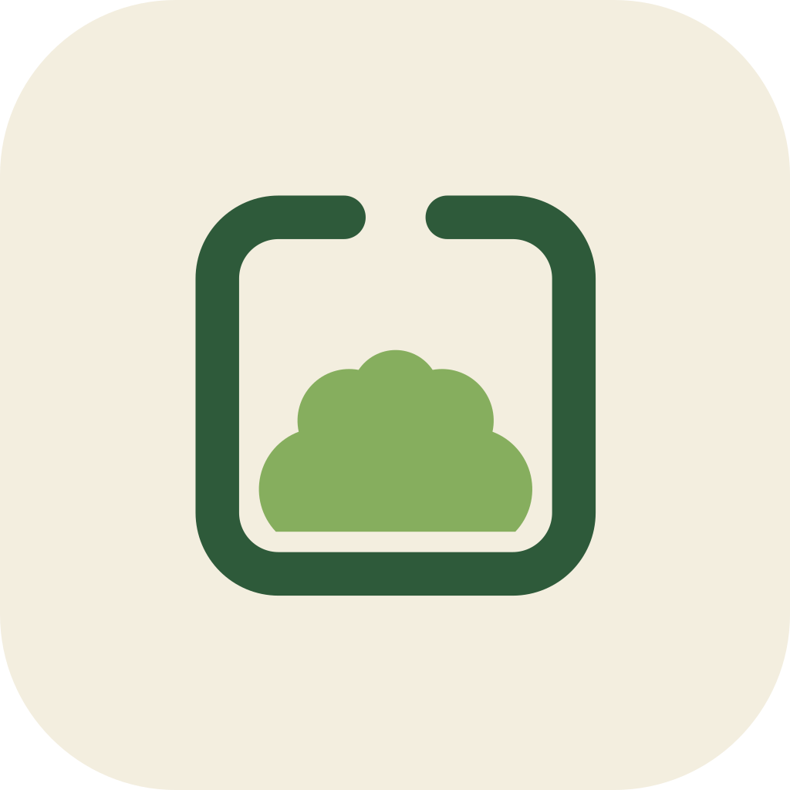
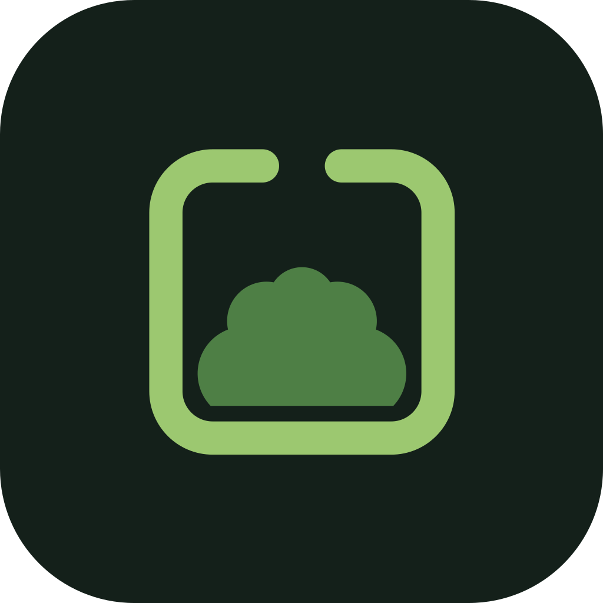
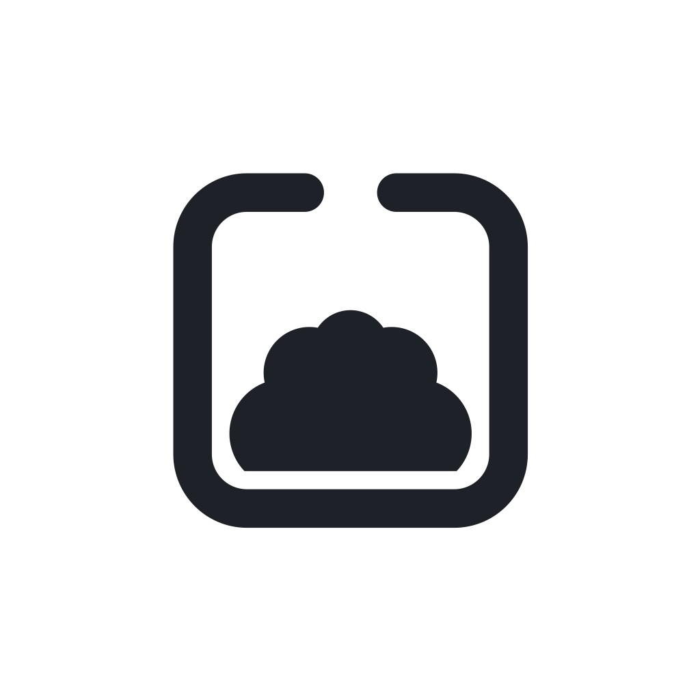

# Penmoss brand: the Moss Pen mark

Ryan chose the Moss Pen (option 05 on the [logo canvas](https://claude.ai/artifact/2WesJC1tABmuekgrfBzUga)) on 24 Oct 2026 (A402). A _pen_ is an enclosure: the mark is a fenced plot, drawn as a rounded-square outline with its gate open at the top, and a mound of moss kept inside. It stands for your own patch, self-hosted.

| Light                                   | Dark                                  | One colour                             |
| --------------------------------------- | ------------------------------------- | -------------------------------------- |
|  |  |  |

## The mark

Every file is written by [`scripts/brand-assets.mjs`](../scripts/brand-assets.mjs) from one geometry, the canvas's own, on a 1024 × 1024 grid:

- **Tile:** a rounded square, corner radius 228.
- **Fence:** a 64-unit stroke with round caps around the square from 250 to 774, corner radius 90. It stops at x 436 and starts again at 588, which leaves the gate open at the top.
- **Moss:** five arcs over a flat base at y 712, from x 336 to 688, inside the fence.
- **Placement:** the fence and moss are scaled by 0.882 and moved 61.2 right and down, so the mark sits centred, 322 units from the centre at its corners.
- **Small cut**, for 32 px and below (the favicon and the in-app mark): the same shapes, scaled by 1.415 and moved −212.5, so the fence spans 13 of 16 px. At 16 px that makes the fence 1.4 px and the gate 2 px wide. With the standard placement they would be 0.9 px and 1.2 px, and the gate would close up.

Do not change the mark's colours to follow the app's theme, close the gate, rotate the mark, or add effects. To change the mark, edit the script and run `task brand`.

## Colours

| Use                 | Tile                   | Fence                 | Moss                |
| ------------------- | ---------------------- | --------------------- | ------------------- |
| Light (primary)     | Warm paper `#F3EEDF`   | Deep forest `#2E5A3A` | Moss `#86AE5E`      |
| Dark                | Night forest `#14201A` | Fern `#9CC870`        | Deep moss `#4E7F45` |
| One colour          | White `#FFFFFF`        | Ink `#1E2228`         | Ink `#1E2228`       |
| One colour, inverse | Slate `#2A2E33`        | White `#FFFFFF`       | White `#FFFFFF`     |

These are the logo's own colours. They are not theme tokens, and they do not change with the theme Ryan picks (A402).

## Clear space and minimum size

- **Clear space:** keep at least one eighth of the tile's width clear around the tile (128 on the 1024 grid; 3 px around the 22 px mark in the app bar). Without the tile, keep a quarter of the fence's width (150 units) clear around the fence.
- **Minimum size:** use the small cut from 16 px to 32 px, and the standard placement above 32 px. Nothing smaller than 16 px. The mark without its tile (the Android capture glyph) is at least 16 dp.

## Where each asset lives

| Asset                           | File                                                                                                  | Notes                                                                                                                                                                                                                                                                                                                                                                                                            |
| ------------------------------- | ----------------------------------------------------------------------------------------------------- | ---------------------------------------------------------------------------------------------------------------------------------------------------------------------------------------------------------------------------------------------------------------------------------------------------------------------------------------------------------------------------------------------------------------- |
| Favicon                         | `apps/web/public/favicon.svg`                                                                         | Small cut. Shows the dark tile when the browser is dark (`prefers-color-scheme`). The service worker caches it with the shell.                                                                                                                                                                                                                                                                                   |
| In-app mark                     | `packages/ui/src/icons/brand-mark-light.svg`, `brand-mark-dark.svg`                                   | Small cut. Drawn by `BrandMark` (`@penmoss/ui/icons`) in the sidebar and the phone's app bar. The stylesheet picks the variant from the page's mode.                                                                                                                                                                                                                                                             |
| Mac and Linux icon              | `apps/desktop/build/icon.svg` → `icon.png` (1024 px)                                                  | Apple's grid: an 824 px squircle (radius 185.4, smoothing 0.6) inset 100 px, with a soft shadow. electron-builder makes the `.icns` from the PNG; Linux uses the PNG. The app has no tray or menu-bar icon.                                                                                                                                                                                                      |
| Android launcher                | `apps/android/app/src/main/res/mipmap-anydpi/ic_launcher.xml`, `ic_launcher_round.xml`                | Adaptive icon. The background is `ic_launcher_background` (`values/brand_colors.xml`). The foreground is `drawable/ic_launcher_foreground.xml`, and the monochrome layer for themed icons (Android 13+) is `drawable/ic_launcher_monochrome.xml`. The canvas's tile maps onto the 72 dp a launcher shows, so the mark reaches 22.6 dp from the centre, inside the 33 dp safe zone. `LauncherIconTest` checks it. |
| Android capture tile and widget | `apps/android/app/src/main/res/drawable/ic_capture.xml`                                               | The mark without its tile, 24 dp. It uses `brand_fence` and `brand_moss` (light and night `brand_colors.xml`). The Quick Settings tile draws it as a silhouette.                                                                                                                                                                                                                                                 |
| Masters                         | `docs/brand/moss-pen-light.svg`, `moss-pen-dark.svg`, `moss-pen-mono.svg`, `moss-pen-small-light.svg` | The tiles shown above.                                                                                                                                                                                                                                                                                                                                                                                           |

`task brand` writes all of these, then renders the Mac PNG with Electron (`apps/desktop/scripts/render-icon.mjs`, under `xvfb-run` on Linux). The web app has no web manifest, `apple-touch-icon` or PNG favicon, so none of those are made.

Before and after screenshots are in [`docs/evidence/logo/`](evidence/logo/).
