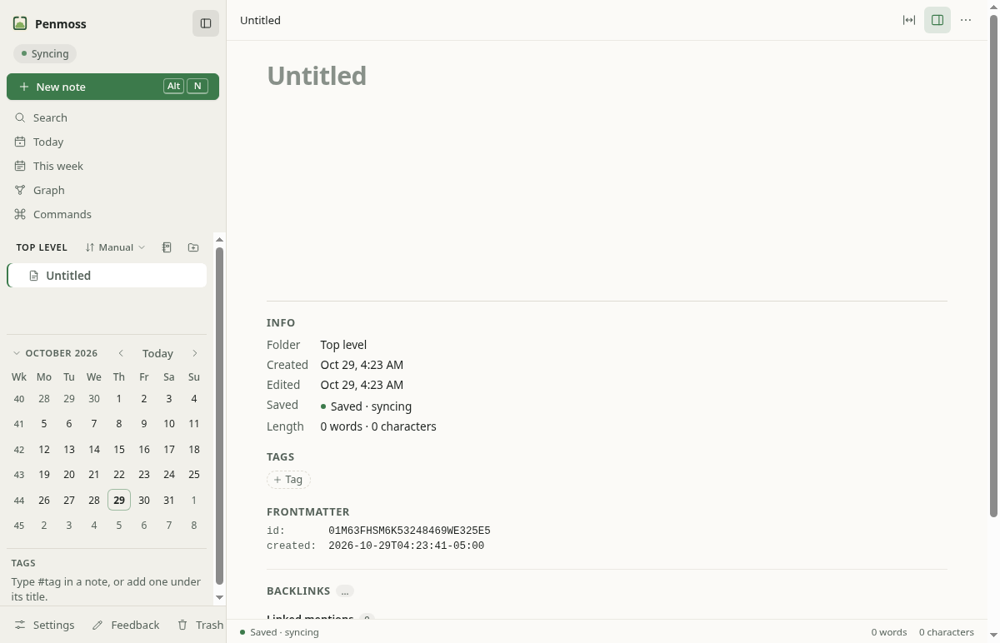
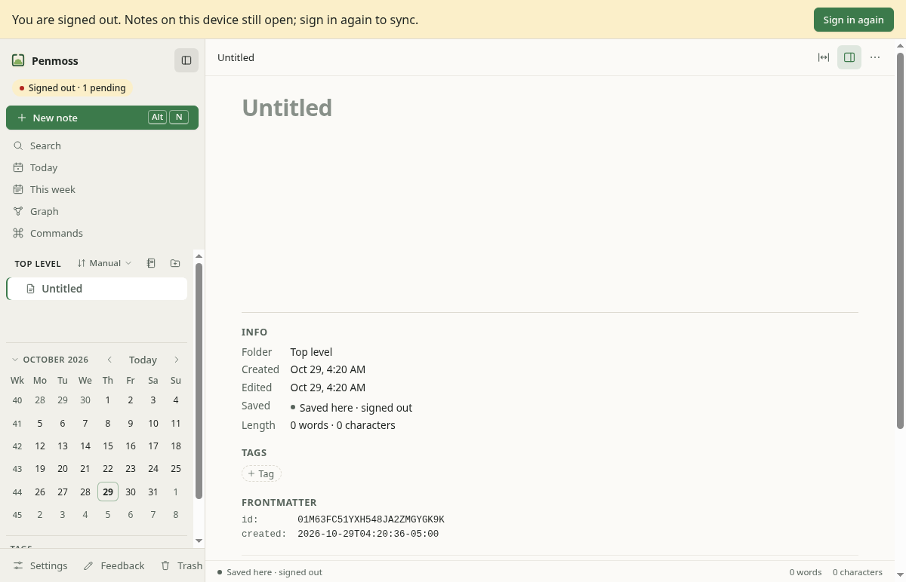

# T50 G0: git notebooks spike and gate

Issue [#148](https://github.com/htxryan/penmoss/issues/148), part of [#147](https://github.com/htxryan/penmoss/issues/147). Run on the agent worker (VM 108, Linux), 28–29 Oct 2026. Spike code: [`spikes/git-notebook/`](../../../spikes/git-notebook/README.md) (not shipped).

**Numbering.** The issues call this feature T49; T49 is now in-app feedback, so it is **T50** here. #147's decision numbers were taken by other lanes, so they move:

| In #147 / #148 | Here                         | Note                                                                                        |
| -------------- | ---------------------------- | ------------------------------------------------------------------------------------------- |
| D41            | **D43**                      | Git notebooks                                                                               |
| A740 … A749    | **A820 … A829** (in order)   | A740 → A820, A741 → A821, A742 → A822, A743 → A823, A744 → A824, … A749 → A829              |
| A750 … A752    | **A830 … A832**              | The next lane's block (G1+G2, A830–A839), as LANE-RULES says ("this lane block and the next ones"); that lane starts its own at A833 |

The spike's design changes below are amendments to these renumbered decisions. As #147 says, the decisions go into `docs/decisions.md` and the plan when the work lands (G1 onwards), not in this spike.

## Recommendation: **GO**, with six design changes and one Android decision for Ryan

- **The format works.** Per-writer Yjs logs, with every commit built on the remote head, converged in every random run. Local bare repos, private github.com repos and a `docs/notes/` directory inside a code repo with a colleague pushing all passed, with no git conflict and no merge commit. Each clone's own full render matched the head byte for byte. Delete for good never came back.
- **The sizes are small.** A year of daily notes is under 1 MB on the host and a 1,000-note notebook is 1.9 MB. A 10,000-word note edited 1,000 times is 1 MB. Compaction isn't needed in v1. **Housekeeping of the local clone is**: 91 MB without `git gc`, 1.1 MB with it.
- **Sync is fast enough** for the 60 s / 2 min cadence. Against github.com a sync takes 1.6 s at the median and 2.0 s at p95, even for a 1,000-note notebook, and a no-op sync takes 0.5 s.
- **JGit works on the JVM** against the private repo with 1,000 notes, in a 48 MB heap: shallow clone 1.4 s, push 1.2 s. It adds 0.79 MB to the APK. But **JGit 6.7 and later call Java methods Android only has from version 13**, so #147's "JGit 6" would crash on Android 11 and 12 (the app's minSdk is 30). Use **JGit 6.6.1**, or raise minSdk for git notebooks to 33 (details below). The Pixel run is pending.
- **The app survives `*.penmoss.app` being blocked**: a usable window in under 0.5 s, with no request at launch when signed out. Two existing problems need fixing in G4 and G5. When connections are silently dropped, a signed-in app hangs on every server request and says "Syncing" forever. Backlinks come from the server.
- The design changes, against #147: own files by content ids (A821), name claims only in landed commits (A823), hand-edited files in the render set (A823), clone housekeeping (A822, A824), the JGit version and setup on Android (A824), and salted periodic notes (A820).

Go means: start G1+G2 (the shared engine, Node transport, CLI and local MCP) with these changes. The Android slices (G7, G8) also wait for Ryan's Pixel run and his choice of JGit 6.6.1 at minSdk 30, or minSdk 33 for git notebooks.

## Acceptance criteria

| #148 criterion                                                                                                                                                                       | Result                       | Evidence                                                                                                                                                                                                                                                                      |
| ------------------------------------------------------------------------------------------------------------------------------------------------------------------------------------ | ---------------------------- | ----------------------------------------------------------------------------------------------------------------------------------------------------------------------------------------------------------------------------------------------------------------------------- |
| After every random run, all clones hold identical docs and `<dir>` trees, git never reports a conflict, no committed file is renamed except on a concurrent claim, a purged note never comes back | **Pass**                     | [Convergence](#convergence): 200/200 local runs, 3/3 on github.com, plus the directory runs. The checks fail on purpose under five deliberate bugs ([the checks have teeth](#the-checks-have-teeth)).                                                                          |
| In the directory run, other committers' files and commits are untouched and no file outside `<dir>` changes                                                                         | **Pass**                     | [Directory target](#directory-target): 30/30 local, 3/3 on a private github.com code repo, with a colleague pushing code, editing rendered notes by hand and adding a hand-made note.                                                                                           |
| JGit clone, fetch and push succeed on the Pixel, with the numbers recorded                                                                                                           | **Pending Ryan**             | On the worker's JVM: pass ([JGit](#jgit)). APKs built and published for the Pixel. [Ryan's steps](#ryan-1-jgit-on-the-pixel).                                                                                                                                                 |
| Sizes and timings are recorded with a recommendation on compaction                                                                                                                   | **Pass**                     | [Sizes](#sizes): compaction not needed in v1; clone housekeeping is.                                                                                                                                                                                                          |
| The server-blocked findings are listed, each mapped to the slice that fixes it                                                                                                       | **Pass** (Linux build); **pending Ryan** for the packaged Mac app | [Server blocked](#server-blocked). [Ryan's Mac steps](#ryan-2-the-mac-app-with-penmossapp-blocked).                                                                                                                                                       |
| The results are in `docs/evidence/t49/g0.md` (here `docs/evidence/t50/g0.md`), and Ryan says go, or changes the design                                                              | **Pending Ryan** (the go)    | This document.                                                                                                                                                                                                                                                                |
| Verification: `node spikes/git-notebook/converge.mjs --runs 200` green with random seeds                                                                                            | **Pass**                     | 200/200 (below).                                                                                                                                                                                                                                                              |
| Verification: a Pixel screen recording of the JGit push; the github.com scratch repo's commit list                                                                                  | **Pending Ryan** / **pass**  | Commit lists: [`pixel-1000`](https://github.com/htxryan/penmoss-git-notebook-scratch/commits/pixel-1000), [`sizes-daily-year`](https://github.com/htxryan/penmoss-git-notebook-scratch/commits/sizes-daily-year), [`sizes-big-note`](https://github.com/htxryan/penmoss-git-notebook-scratch/commits/sizes-big-note) (private). |

## What the spike built

- **A Node prototype of the format and engine** (`lib/notebook.mjs`), running today's code: the server mirror's `renderNote`, `assignFolders`/`uniqueName` paths, the note and WorkspaceDoc helpers, and the periodic-note builder. It is bundled from the repo, not copied (`src/penmoss-entry.ts`), so the markdown is byte for byte what the mirror writes.
  - Layout (A821): `<dir>/.penmoss/{notebook.json, actors/<writer>.json, workspace/<writer>.yjs, notes/<id>/<writer>.yjs}` and the rendered `.md` files.
  - A writer is bound to a secret held outside the profile, as a keychain would hold it. A copied profile gets a new writer id.
  - The sync cycle (A822): fetch, apply the changed logs, recompute own files, render, commit on the remote head, fast-forward push, and rebuild up to 3 times when rejected.
  - The render (A823): `updated` from per-writer keys, names stored in the WorkspaceDoc, the older id winning a clash, and the render set. Delete for good uses a `purged` map.
- **A system-git transport** (`lib/git.mjs`), as G2 would build it.
  - git is spawned without a shell, with `GIT_CONFIG_GLOBAL=/dev/null`, `GIT_CONFIG_NOSYSTEM=1` and `GIT_TERMINAL_PROMPT=0`. The token goes through `GIT_ASKPASS` only.
  - A partial clone (`--filter=blob:none`) with a sparse cone on the directory.
  - **Commits are built with plumbing in a temporary index** (`read-tree <head>`, `update-index --index-info`, `write-tree`, `commit-tree -p <head>`). Nothing is ever merged or rebased, and no local work is checked out.
- **Three harnesses:** `converge.mjs`, `sizes.mjs`, and `server-blocked/` (the Mac app's build under xvfb). There is also a **JGit probe**: plain Java run on the JVM, and a throwaway Android activity with R8 in three flavors.
- **Two private scratch repos**, both checked `visibility: private` before every write (A761):
  - `htxryan/penmoss-git-notebook-scratch` (root target, sizes, and the Pixel's `pixel-1000` branch);
  - `htxryan/penmoss-git-notebook-code-scratch` (the directory target).

## Convergence

`node spikes/git-notebook/converge.mjs --runs 200` (local `file://` bare repos with `uploadpack.allowFilter`):

**200/200 runs green** in 715 s, on the final code. The runs held 1,782 notes in all (median 9, at most 15) across 4 writers, and made:

- 4,654 Penmoss commits;
- 678 pushes rejected because another clone landed first, each rebuilt on the new head, with no sync needing a fourth attempt;
- 919 interleaved syncs;
- 198 crashes between commit and push, and 199 pushes that landed with their app dying before it recorded them;
- 236 Deletes for good;
- 200 copied profiles, each given a new writer id.

Files moved 996 times for a title change and 1,009 times for a folder change, and **0 times for a clash**. A run takes 3.6 s at the median and 4.8 s at most.

Each run starts three clones of one notebook: A and B are devices, C is an agent writer. A makes the notebook, B and C add the same remote. Then come 60 random steps:

- **Edits on a random clone:** body edits with links to other notes, new notes, new folders, renames of notes and folders, moves of notes and folders, Trash and restore, Delete for good.
- **Syncs:** plain syncs, and interleaved syncs, where one clone commits, another syncs in between, and the first one's push is rejected and rebuilt.
- **Every scenario #148 lists, once per run, at a random step:**
  - the same daily note made offline on two clones (A4, A76);
  - a note renamed on one clone while its folder is renamed on another (and sometimes on a third);
  - two notes titled "Standup" made offline on two clones, whose commits race;
  - Delete for good on A while B holds the note and edits it offline;
  - a crash between commit and push;
  - a push that lands but whose app dies before recording it;
  - a profile copied to a fourth clone D: the same data and git clone, no secret, so a new writer id. D then keeps editing.

At the end every clone syncs until a whole round commits nothing. Then the name "Standup" is freed (its holder is retitled) and they settle again.

The checks after every run (`lib/check.mjs`):

1. **Every clone ends on the same head**, with equal WorkspaceDoc and note content, equal content ids (inserts and deletes) and equal state vectors.
2. **Each clone renders its own state in full, and every byte equals the file at head.** No Penmoss-written file at head is stale.
3. **The history:** `git fsck` passes and there are no merge commits. Every Penmoss commit says `Penmoss: <n> notes [skip ci]` and touches only the directory. Between consecutive commits a note's file moves only for:
   - its title,
   - its folder (moved, renamed, or a sibling-name suffix),
   - a lost concurrent claim (an older note now holds the name, counted as "clash"),
   - or a hand-made file now holding the name ("foreign", A217).
4. **A purged note** has no logs and no file in any commit after its purge commit, and no clone holds it.
5. **The daily note** holds its template once.
6. **The same-title notes** have different names, and the stored name doesn't move when the plain name is freed.
7. **The render set** never misses a file the full render would change (checked on every sync).

### The checks have teeth

Each deliberate bug (`SPIKE_MUTATE=…`) is caught:

| Bug                                                       | Caught                                                                   |
| --------------------------------------------------------- | ------------------------------------------------------------------------ |
| `purge`: logs of purged notes still applied               | 5/5 runs: no fixed point, the note comes back again and again            |
| `own-at-head`: a writer's file drops what it had          | 15/15: no fixed point (the other writers keep copying the lost content back, so nothing is lost, but it never settles) |
| `render-clock`: `updated` from the wall clock             | 5/5: renders differ between clones and from the head                    |
| `render-set`: only this device's edits re-render          | 7/15 runs (it needs a linked note renamed elsewhere); certain over 200   |
| `no-claims`: stored names ignored                         | 15/15: a file renamed with no cause, or a name moving to an older note   |

### On github.com

`--remote github` against `htxryan/penmoss-git-notebook-scratch`, one branch per run, deleted after:

**3/3 green** on the final code, plus a replay of an earlier failed seed: 64 commits, 10 rejected pushes rebuilt, 3 crashes, 3 lost pushes, 5 Deletes for good, 3 copied profiles, 0 clash renames.

Over the spike, 21 runs on github.com passed: 16 at the root and 5 directory runs. Three failed for reasons in the harness, not the engine:

- the checker read `git diff` output with core.quotePath on, so it misread paths with "é" in them (fixed; the run's branch passes the fixed checker);
- the spike's own clean-up deleted a run's scratch folder while that run was still going;
- a run's branch could not be deleted afterwards: it was the first branch pushed to an empty repo, which GitHub made the default. Its checks had passed; clean-up now tolerates that.

## Directory target

`--dir docs/notes --committer`: the notebook lives in `docs/notes/` of a code repository. It has `README.md` and `src/app.js` at the top and a hand-written `docs/notes/README.md`. A colleague with a normal full clone pushes code during the run, and sometimes:

- edits the top-level README;
- adds a line by hand to a rendered note;
- adds a hand-made `docs/notes/Ideas.md` with no frontmatter, a name a Penmoss note already has.

| Run                                                                    | Result                                                                                                                                                       |
| ---------------------------------------------------------------------- | ------------------------------------------------------------------------------------------------------------------------------------------------------------ |
| Local, 30 runs                                                         | **30/30 green**. 712 Penmoss commits, 108 colleague pushes, 102 rejected pushes rebuilt. 49 hand edits, all overwritten by the next render (28 caught as such; the rest re-rendered for their own reasons). The hand-made note appeared in 18 runs: Penmoss left it alone and moved its own "Ideas" to a suffixed name 5 times. |
| github.com, `htxryan/penmoss-git-notebook-code-scratch` (private), 3 runs | **3/3 green**. 74 Penmoss commits, 12 colleague pushes, 9 rejected pushes rebuilt. 8 hand edits, 6 caught and overwritten. The hand-made note appeared in one run and was left alone. 3–13 blobs outside the cone were never fetched.                                                                                                                                                     |

Checked after every run:

- The colleague's files are exactly as pushed, and so is the hand-made note.
- No Penmoss commit touched anything outside `docs/notes/`.
- The partial clone never fetched the blobs outside the cone: from 1 to 19 blobs were missing in every run, so `--filter=blob:none` was honoured.
- The sparse checkout held only top-level files and `docs/notes/`. Cone mode always includes top-level files, a small cost.
- Penmoss's pushes, built on the remote head, interleaved with the colleague's pushes and never needed a merge.

## The two places the spike changes #147's design (measured)

### Own files by content ids, not state vectors (A821, amends #147's A741)

#147's formula is `mergeUpdates(own at head, encodeStateAsUpdate(localDoc, stateVector(head)))`. `encodeStateAsUpdate` always carries the doc's **whole delete set**. So after any writer deletes anything, every other writer's file changes on its next sync (it copies the deletes) and commits, even when that writer changed nothing.

The spike takes the difference over content ids instead: `excludeContentIds(contentIds(local), contentIds(merged head))`, then `intersectUpdateWithContentIds(local, missing)`. This carries exactly the inserts **and deletes** the head lacks, whoever made them. Nothing is marked sent, so a lost push still loses nothing.

On the same 30 seeds:

| Own file                  | Penmoss commits | Log bytes at the end |
| ------------------------- | --------------- | -------------------- |
| #147 (`SPIKE_OWNFILE=spec`) | 1,029           | 256 KB               |
| Content ids (the spike)    | 708 (−31%)      | 243 KB (−5%)         |

Both converge. (The seeds diverge a little once the commit counts differ, so this is indicative, not exact.)

### Name claims only in commits that land (A823, amends #147's A743)

#147 writes a claim into the local WorkspaceDoc when a writer renders. If that commit's push is rejected, or the app crashes before pushing, the claim stays in the local doc. The rebuild then carries a claim that never landed against one that did, and when the stale claim is the older note's, a **committed** file is renamed.

The spike writes claims into a fork of the WorkspaceDoc, which joins the local doc only once its commit lands. Every claim is then made against the head's claims, so two can never collide, and **a committed name never moves**. The older-id rule stays as a tie-break that never fires.

| Claims                    | Runs | Committed files renamed by a clash |
| ------------------------- | ---- | ---------------------------------- |
| #147 (`SPIKE_CLAIMS=local`) | 30   | 9                                  |
| Landed only (the spike)   | 30 + 200 | **0** (the checker fails a run on any) |

The fork has its own Yjs client id, which joins the actor file only when its claims land. That is one more client id per sync that claims a name: rare.

## Sizes

`node spikes/git-notebook/sizes.mjs --scenario …`, one device writer, locally and against the private github.com repo (branches `sizes-big-note`, `sizes-daily-year`, `pixel-1000`). Bytes are file sizes in the repo; "after gc" is the host's object store after `git gc --aggressive` (GitHub repacks too).

|                                                         | One 10,000-word note, 1,000 bursts                       | A year of daily notes               | 1,000 notes                  |
| ------------------------------------------------------- | -------------------------------------------------------- | ----------------------------------- | ---------------------------- |
| What                                                    | 9,834 words, then 1,000 bursts (typing, backspaces, cuts, new paragraphs), a commit after each: 1,001 commits, 16,230 words at the end | 365 daily notes from the template, 3–10 bursts each, a commit a day | 1,000 notes of 150–450 words in 20 folders, one commit, then 50 edit syncs and a folder rename |
| Writer logs (`.yjs`, notes)                             | 194 KB (one file)                                        | 413 KB (largest 1.9 KB)             | 2.18 MB (largest 3.2 KB)     |
| WorkspaceDoc log                                        | 0.1 KB                                                   | 61 KB                               | 183 KB                       |
| Rendered markdown                                       | 101 KB                                                   | 164 KB                              | 1.77 MB                      |
| The note's doc re-encoded (what compaction would give)  | 200 KB, the same as before: deleted text is already garbage-collected | n/a                    | n/a                          |
| Host's objects after gc                                 | **0.98 MB** (6.0 MB before)                              | **0.84 MB** (9.0 MB before)         | **1.9 MB** (4.1 MB before)   |
| New device, full clone from github.com                  | 1.8 MB in 1.0 s                                          | 0.95 MB in 0.75 s                   | 1.9 MB in 0.79 s             |
| New device, shallow clone (`--depth 1`)                 | 0.10 MB in 0.70 s                                        | 0.48 MB in 0.75 s                   | 1.85 MB in 0.84 s            |
| The device's own clone, never gc'd                      | **91 MB**, **1.1 MB** after `git gc`                     | 23 MB                               | 16 MB                        |
| Sync, local bare repo (p50 / p95)                       | 83 / 118 ms                                              | 85 / 126 ms                         | 170 / 229 ms                 |
| Sync, github.com (p50 / p95)                            | 1,595 / 1,771 ms                                         | 1,615 / 1,811 ms                    | 1,737 / 2,045 ms             |
| github.com fetch / push (mean)                          | 400 / 1,165 ms                                           | 393 / 1,177 ms                      | 414 / 1,193 ms               |
| Second device's first sync / a no-op sync (github.com)  | 2.6 / 0.48 s                                             | 2.9 / 0.48 s                        | 3.1 / 0.47 s                 |

The 1,000 notes' first commit took 0.97 s locally and 2.9 s on github.com. Renaming a top-level folder (about a tenth of the notes, with its subfolder) re-renders every note under it: 0.2 s locally, 1.7 s on github.com.

**Compaction: not needed in v1.** Re-encoding a writer's log gains nothing: Yjs already reduces deleted text to tiny markers. History grows by about 1 KB per commit on the host after its own repacking: 0.98 MB for 1,000 commits of the biggest note there is. At that rate a heavy user reaches 50 MB in years. The follow-up's trigger: a writer log over 1 MB, or a fresh full clone over 50 MB.

**What v1 does need: housekeeping of the device's clone** (A822, A824). Every commit writes loose objects into the clone, so it grew to 91 MB over 1,000 commits. The fix differs by client:

- Mac and CLI: run `git gc --auto` or `git maintenance run --auto` after a sync. One gc brought it to 1.1 MB.
- Android: never run JGit's gc (below). The clone is disposable, so throw it away and clone again shallow when the object store passes a size, say 20 MB, which takes about 1.4 s for 1,000 notes.

## JGit

The probe (`jgit/probe/GitProbe.java`) does what the Android transport must do, and times each step:

1. a shallow clone (`setDepth(1)`, one branch, no checkout);
2. list the tree and read every writer log at head;
3. fetch;
4. a commit on the remote head built in an in-memory `DirCache` (no working tree, no merge);
5. a fast-forward push;
6. a push of a commit on the old head, which **must be rejected** `REJECTED_NONFASTFORWARD`;
7. a fetch, then a rebuild on the new head and a push.

The same class runs on the JVM and in the Android activity.

**On the worker's JVM** (JDK 21, a 192 MB heap, a small `WindowCache`) against `pixel-1000` on github.com: 1,000 notes, 2,000+ files, 2.4 MB of logs.

| Step                                   | JGit 6.6.1 (3 runs)  | JGit 6.10.1 (3 runs; the first on a cold JVM) |
| -------------------------------------- | -------------------- | ------------------------------------------- |
| Shallow clone                          | 1.35–1.41 s          | 1.36–1.38 s (4.36 s cold)                   |
| List the tree / read every log         | 3–7 ms / 17–33 ms    | 3–4 ms / 17–28 ms                           |
| Fetch (nothing new)                    | 0.58–0.59 s          | 0.58 s                                      |
| Commit on head                         | 14–30 ms             | 14–21 ms                                    |
| Push                                   | 1.16–1.30 s          | 1.14–1.23 s                                 |
| Stale push (rejected, as it must be)   | 0.37–0.39 s          | 0.37–0.39 s                                 |
| Rebuild and push                       | 1.12–1.16 s          | 1.12–1.22 s                                 |
| Peak heap                              | 41–42 MB             | 42 MB (120 MB cold)                         |
| `.git` after                           | 1.9 MB               | 1.8–1.9 MB                                  |

With the heap capped at 48 MB, both pass with a 31.5 MB peak. The probe's commits are in the [`pixel-1000` history](https://github.com/htxryan/penmoss-git-notebook-scratch/commits/pixel-1000) as "Penmoss: 1 note [skip ci]" by "Penmoss JGit probe".

**APK size** (`jgit/app`, AGP 9.4.1, R8 full mode, `minSdk 30`): the same activity with and without JGit.

| Flavor                 | APK      | Download (gzip) | dex      | JGit adds                     |
| ---------------------- | -------- | --------------- | -------- | ----------------------------- |
| `bare` (no JGit)       | 20.8 KB  | 16.1 KB         | 1.2 KB   |                               |
| `jgit661` (JGit 6.6.1) | 807.9 KB | 430.5 KB        | 768.1 KB | **+787 KB, +414 KB download** |
| `jgit610` (JGit 6.10.1) | 826.4 KB | 439.3 KB        | 785.8 KB | +806 KB, +423 KB download     |

This is a separate throwaway app with the shipping app's AGP, R8 mode and minSdk; the shipping app is unchanged. JGit shares no code with what the Penmoss app already bundles (Compose, OkHttp, Room), so adding it there should cost about the same. These include commons-codec, JavaEWAH and slf4j-api. commons-codec's 234 KB of phonetic rules are excluded from packaging; JGit never uses them.

**Android compatibility, checked against the bytecode.** I scanned each jar's constant pool for `java.io.InputStream` methods Android only has from API 33:

| JGit            | Classes calling them                                                                                   | On an Android 11 or 12 device (minSdk 30)                                                                                             |
| --------------- | ------------------------------------------------------------------------------------------------------ | ------------------------------------------------------------------------------------------------------------------------------------ |
| 6.10.1 (and 7.x) | `util/IO` (`readAllBytes`, `readNBytes`), the object-size index, `DirCacheCheckout` (`transferTo`), `PatchApplier` | **`NoSuchMethodError` as soon as a repo is read**: `IO` reads config, refs and pack indexes. Reported on SDK 30 devices ([Visual-Code-Space #209](https://github.com/Visual-Code-Space/Visual-Code-Space/issues/209)). Desugaring doesn't provide these methods. |
| **6.6.1**       | only the object-size index (opt-in), `DirCacheCheckout` (checkout) and `PatchApplier`                  | **Works**: Android never checks out (the engine reads blobs), and the other two are never used. It has shallow clone (since 6.3).      |
| 5.13.5          | none                                                                                                   | Works, but has **no shallow clone**: every device would clone the whole history.                                                      |

R8 reports these classes missing against `android.jar`. Each is safe only with the setup noted (`jgit/app/proguard-rules.pro`):

- **`java.lang.management`, `javax.management`:** JMX statistics. Turn them off with `WindowCacheConfig.setExposeStatsViaJmx(false)`.
- **`org.ietf.jgss`:** HTTP Negotiate (Kerberos). It is reached only when a server answers 401 with `WWW-Authenticate: Negotiate`. github.com never does, but a corporate host might, and then the class load throws an `Error`. G7 must catch `Throwable` around transport calls and show "can't authenticate".
- **`java.lang.ProcessHandle`:** gc's pid lock. **Never run JGit's gc on Android**; re-clone instead (above).

JGit's message bundles are found by class name and loaded through a no-arg constructor, so R8 must keep their names and constructors. AGP 9's strict full mode keeps no constructor unless told to.

**Pending Ryan:** the probe has not run on a device (no emulator, no Pixel here). The APKs are built and published ([steps](#ryan-1-jgit-on-the-pixel)).

## Server blocked

`server-blocked/run.mjs` launches the Mac app's build (`task desktop:build`, unpackaged, Electron 45) under xvfb against the production origins, with `*.penmoss.app` blocked by Chromium's `--host-resolver-rules` for that process only. Every request the main process makes goes through Chromium (`net.fetch`), so the net log covers the main process as well as the page. Three ways a network blocks a host:

- **drop:** connections hang, like pf `block drop`.
- **refuse:** connections are refused at once, like pf `block return`.
- **nxdomain:** the names don't resolve.

Each runs signed out (a fresh profile) and signed in (a device token stored as the app stores one, fake, so the server could only refuse it). Each launch makes a new note with Alt+N and watches for 60 s.

| Mode     | State      | Window / usable          | Requests to penmoss.app in 60 s                                                                                                                                                                                                                                            | What the window says                                                                 | Quit  |
| -------- | ---------- | ------------------------ | ------------------------------------------------------------------------------------------------------------------------------------------------------------------------------------------------------------------------------------------------------------------------- | ------------------------------------------------------------------------------------ | ----- |
| drop     | signed out | 0.25 s / 0.45 s          | **none**                                                                                                                                                                                                                                                                   | "You are signed out … Sign in again", "Signed out · 1 pending"; the new note works   | 29 ms |
| refuse   | signed out | 0.18 s / 0.43 s          | none                                                                                                                                                                                                                                                                       | the same                                                                             | 38 ms |
| nxdomain | signed out | 0.17 s / 0.36 s          | none                                                                                                                                                                                                                                                                       | the same                                                                             | 28 ms |
| drop     | signed in  | 0.15 s / 0.31 s          | **9, every one hanging until the window closed**: 2 × `wss /sync/workspace`, 1 × `wss /sync/notes/<id>`, `OPTIONS /sync/changes`, 2 × `OPTIONS /api/notes`, and `OPTIONS /api/notes/<id>/backlinks` every 20 s                                                              | **"Syncing" forever**; the note says "Saved · syncing"; Backlinks spins              | 34 ms |
| refuse   | signed in  | 0.19 s / 0.32 s          | 103, each failing at once (`ERR_CONNECTION_REFUSED`): sync sockets retried after 0.25 s, doubling to a 10 s cap, each try with two CORS preflights; backlinks every 20 s                                                                                                                 | "Offline · 1 pending … they sync when you reconnect"                                 | 33 ms |
| nxdomain | signed in  | 0.17 s / 0.33 s          | 103, the same with `ERR_NAME_NOT_RESOLVED`                                                                                                                                                                                                                                 | "Offline · 1 pending"                                                                | 26 ms |





No launch hung and no quit hung. Nothing asked for fonts (bundled) or a service worker (the Mac app has none).

### Findings, each mapped to the slice that fixes it

| #   | Finding                                                                                                                                                                                                                                                         | Fix in                                                                                                                                                                                                                                       |
| --- | --------------------------------------------------------------------------------------------------------------------------------------------------------------------------------------------------------------------------------------------------------------- | -------------------------------------------------------------------------------------------------------------------------------------------------------------------------------------------------------------------------------------------- |
| S1  | With no account, the app shows the sign-in banner and "Signed out · 1 pending", and a new note lands in the personal (server) store, where it can never sync.                                                                                                  | **G5** server-less boot (A828): no banner, no personal section, no unsyncable local notes. **G4** routes new notes, daily notes and captures to the Journal notebook (A827).                                                                  |
| S2  | Signed in on a network that **drops** connections: the sync sockets, `/sync/changes`, `/api/notes` and backlinks hang with no timeout. Status says "Syncing" forever and the note "Saved · syncing", so the user can't tell that nothing syncs. This affects today's app too: a laptop carried onto the work network. | **G5** (Status, A825/A828): a connect timeout (about 10 s) on the sync sockets and fetches, then "Offline". It could ship earlier on its own as a small sync-client fix.                                                                        |
| S3  | Backlinks come from the server (`/api/notes/<id>/backlinks`), asked again every 20 s while a note is open.                                                                                                                                                     | **G4** (A826): backlinks, like the graph and tags, from the local index for a git notebook. They must never ask the server.                                                                                                                |
| S4  | Refused or unresolvable: fast failures, right "Offline" status, but about 100 failed requests a minute, as the backoff caps near 10 s, each doubled by CORS preflights, and console errors.                                                                    | **G5**: back off longer (minutes) after repeated name or connection failures; harmless otherwise.                                                                                                                                         |
| S5  | Not exercised on Linux: the **update check** (only a signed, packaged build has a feed, and the downloads bucket doesn't exist yet), **`/api/errors`** (no error was raised), and the macOS-only paths (Keychain, the owner check, Gatekeeper).                  | **Ryan's Mac run** below. The update check must fail quietly (**G5**, A828); error reports must never name a git note (**G4**, A826).                                                                                                      |
| S6  | Sign in, and Settings → Devices, would call the server and hang under drop.                                                                                                                                                                                    | **G5**: hidden in a server-less boot (A828).                                                                                                                                                                                              |

## Design changes the spike suggests, against #147

Numbers are the renumbered decisions (old numbers in brackets).

1. **A821 [A741] Own files by content ids.** Use `excludeContentIds` and `intersectUpdateWithContentIds` rather than `encodeStateAsUpdate(local, stateVector(head))`: 31% fewer commits ([above](#own-files-by-content-ids-not-state-vectors-a821-amends-147s-a741)). Also say that Delete for good is the one case where a writer removes other writers' files.
2. **A823 [A743] Claims only in landed commits.** Write name claims into a fork of the WorkspaceDoc that joins the local doc once its commit lands. Committed names then never move ([above](#name-claims-only-in-commits-that-land-a823-amends-147s-a743)).
3. **A823 [A743] The render set includes files someone else changed.** Add the rendered files changed at head since the last synced head (hand edits, a colleague's commit). Without this, "hand edits are overwritten on the next render" only happens when the note itself changes. Status can list them from the same diff. With no last head, render everything.
4. **A822 [A742] and A824 [A744] Housekeeping of the clone.** On the Mac and CLI, `git gc --auto` or `git maintenance run --auto` after syncs. On Android, re-clone shallow when the object store passes about 20 MB, never JGit's gc. Build commits with plumbing in a temporary index (JGit: an in-core `DirCache`), never touching a working tree. Then a partial clone and sparse cone only ever fetch what the engine reads.
5. **A824 [A744] JGit on Android: 6.6.1, or minSdk 33.** #147 says "JGit 6.x, or 5.13". **Ryan decides**:
   - **(a) JGit 6.6.1 with minSdk 30.** It's the last 6.x without the API-33 calls in its core and has shallow clone. It's older, and missing fixes since 2023, including [CVE-2025-4949](https://osv.dev/vulnerability/CVE-2025-4949): XML parsing in the `repo` command, which the engine never uses.
   - **(b) Git notebooks only on Android 13+ (API 33)**, with current JGit 7.x, which needs desugaring for its other Java 17 calls.
   - 5.13 has no shallow clone.

   The spike recommends **(a)** for v1 and moving to (b) when the app's minSdk reaches 33. The Android setup is the same either way:
   - an isolated `SystemReader` (no user, system or XDG config);
   - `setExposeStatsViaJmx(false)`;
   - a small `WindowCache` (16 MB limit, 8 KB windows, no mmap);
   - `Throwable` caught around transport calls;
   - the R8 rules in `jgit/app/proguard-rules.pro`.
6. **A820 [A740] Salted periodic notes.** `periodicNote` (packages/editor) takes the notebook id as a salt for both the note id and its Yjs client ids. Today it derives both from the period and template only, and a git notebook's daily note must not collide with the server's.
7. **A828 [A748] Purge, as specified, in two places.** The engine must skip purged notes **before applying logs** and **before writing its own files**. The `purge` mutation shows that missing either brings the note back.
8. **A822 [A742] Retries.** 3 rebuilds are plenty: across 4,654 commits and 678 rejected pushes in the 200 runs, no sync needed a fourth attempt.

**Confirmed as specified:**

- A copied profile gets a new writer id from the keychain check.
- Yjs client ids are per document and session, so a copy never reuses one.
- An actor file lists only the writer's own ids.
- The same daily note made offline on two devices has one template body.
- Concurrent renames of a note and its folder converge.
- `[skip ci]`, and no file outside the directory, ever.

**Not covered by the spike (for the slices to test):**

- attachments in the repo;
- folder Trash;
- mixed `renderVersion` clients;
- History and revert (A831);
- signed commits, branch protection and push rules;
- SSH remotes;
- Git Credential Manager prompts;
- the `xcode-select` preflight;
- Windows paths.

## Ryan 1: JGit on the Pixel

About 10 minutes. The probe pushes test commits to the `pixel-1000` branch of the private scratch repo; nothing else.

1. **Make a token.** On github.com: Settings → Developer settings → Personal access tokens → **Fine-grained tokens** → **Generate new token**.
   - Name `penmoss-jgit-probe`, expiration 7 days.
   - Repository access: **Only select repositories** → `htxryan/penmoss-git-notebook-scratch`.
   - Permissions: **Contents: Read and write** (Metadata read-only is added for you).
   - Generate, and copy the token.
2. **Install the probe.** On the Pixel, signed in to GitHub in Chrome, open the [**t50-g0-jgit-probe** release](https://github.com/htxryan/penmoss-git-notebook-scratch/releases/tag/t50-g0-jgit-probe). Download `jgit-probe-6.6.1.apk` and `jgit-probe-6.10.1.apk` and open each to install. Allow Chrome to install apps once, and choose **Install anyway** if Play Protect warns. They are "JGit probe 6.6.1" and "JGit probe 6.10.1", separate from Penmoss.
   - SHA-256: 6.6.1 `0811c982…8de67`, 6.10.1 `882f466e…360c6`.
   - Or with adb from the Mac: `gh release download t50-g0-jgit-probe --repo htxryan/penmoss-git-notebook-scratch`, then `adb install jgit-probe-6.6.1.apk` and `adb install jgit-probe-6.10.1.apk`.
3. **Start a screen recording:** Quick Settings → **Screen record**. #148 asks for one of the push.
4. **Run 6.6.1.** Open **JGit probe 6.6.1**. The repository and branch (`pixel-1000`) are filled in. Paste the token and tap **Run probe**. Each step prints its time. It ends with:
   - peak heap, `.git` size and file count;
   - "total … ms; process PSS …";
   - **RESULT: OK**.

   The stale push must say `REJECTED_NONFASTFORWARD`. Tap **Run probe** twice more (warm runs), then **Copy results** and paste them into the PR.
5. **Run 6.10.1** the same way and copy its results. On a Pixel with Android 13 or later both should pass; 6.10.1 fails only on Android 11 and 12. If your Pixel is on Android 11 or 12, 6.10.1 should fail with `NoSuchMethodError`. Please record that too.
6. **The error path through R8.** In **JGit probe 6.6.1**, change one character of the token and run. It must end "RESULT: FAILED" with a readable "not authorized" message, not a crash. That shows JGit's message bundles survived R8.
7. **Airplane mode.** Turn it on and run: a readable network error, not a crash. Turn it off.
8. Stop the recording. Check the [commit list](https://github.com/htxryan/penmoss-git-notebook-scratch/commits/pixel-1000): new "Penmoss: 1 note [skip ci]" commits by "Penmoss JGit probe".
9. **Clean up:** uninstall both probes (long-press → App info → Uninstall), and delete the token on GitHub.

Send the copied results and the recording, and say which JGit option you want (design change 5).

## Ryan 2: the Mac app with penmoss.app blocked

About 15 minutes, on your Mac with the installed, signed Penmoss (signed in). Each block below pastes as is into zsh. A block that asks for your password has only that one command. The steps change `/etc/hosts` and add a pf rule, and the last blocks undo both.

**1. Is the update check on in this build?** `app-update.yml` present means yes.

```sh
ls -l /Applications/Penmoss.app/Contents/Resources/app-update.yml
```

**2. Back up the hosts file** (asks for your password):

```sh
sudo cp /etc/hosts /etc/hosts.penmoss-backup
```

**3. Point every penmoss.app name at a black hole.** 192.0.2.1 is a documentation-only address nothing answers.

```sh
sudo sh -c 'printf "%s\n" "192.0.2.1 penmoss.app" "192.0.2.1 app.penmoss.app" "192.0.2.1 api.penmoss.app" "192.0.2.1 www.penmoss.app" "192.0.2.1 downloads.penmoss.app" >> /etc/hosts'
```

**4. Make connections to it hang (pf drop), as a corporate firewall would.** The second block loads macOS's own pf rules (which include the `com.apple/*` anchors), adds this one, and turns pf on.

```sh
printf 'block drop out quick inet from any to 192.0.2.1\n' > /tmp/penmoss-block.pf
```

```sh
sudo sh -c 'pfctl -q -f /etc/pf.conf; pfctl -a com.apple/penmoss-block -f /tmp/penmoss-block.pf && pfctl -E'
```

```sh
sudo sh -c 'dscacheutil -flushcache; killall -HUP mDNSResponder'
```

**5. Check the block: this must time out after 5 s (exit 28).**

```sh
curl -m 5 -sS https://api.penmoss.app/health; echo "exit $?"
```

**6. Quit Penmoss if it is open**, then launch it with a net log, timing it with a stopwatch from Enter to a usable window.

```sh
osascript -e 'quit app "Penmoss"'
```

```sh
/Applications/Penmoss.app/Contents/MacOS/Penmoss --log-net-log="$HOME/Desktop/penmoss-blocked-drop.json"
```

Then, in the app:

- note the launch time;
- make a new note (⌘⌥N), type a line, and open Today;
- open Settings → Status and note what it says;
- wait two minutes, then quit with ⌘Q and note whether it quits at once;
- note any dialog: the update check, Keychain, "can't connect".

**7. Again with connections refused instead of hanging** (pf `block return`).

```sh
printf 'block return out quick inet from any to 192.0.2.1\n' > /tmp/penmoss-block.pf
```

```sh
sudo pfctl -a com.apple/penmoss-block -f /tmp/penmoss-block.pf
```

```sh
/Applications/Penmoss.app/Contents/MacOS/Penmoss --log-net-log="$HOME/Desktop/penmoss-blocked-refuse.json"
```

Then do the same as in step 6.

**8. Undo everything** (each asks for your password at most once):

```sh
sudo pfctl -a com.apple/penmoss-block -F all
```

```sh
sudo cp /etc/hosts.penmoss-backup /etc/hosts
```

```sh
sudo sh -c 'dscacheutil -flushcache; killall -HUP mDNSResponder'
```

```sh
curl -m 10 -sS -o /dev/null -w "%{http_code}\n" https://api.penmoss.app/health
```

The last command must print `200`. If pf was off before (`sudo pfctl -s info` said "Status: Disabled"), `sudo pfctl -d` turns it off again.

**9. Summarise the two net logs** (in the repo on the Mac, or send the files):

```sh
node spikes/git-notebook/server-blocked/netlog.mjs "$HOME/Desktop/penmoss-blocked-drop.json"
```

```sh
node spikes/git-notebook/server-blocked/netlog.mjs "$HOME/Desktop/penmoss-blocked-refuse.json"
```

Send the summaries, the launch times and what Status said. Anything not in the table above (S1–S6) is a new finding for G5. The net logs hold URLs and timings, no note text, but they include the hosts the app talked to, so share them only with the agent.

## Reproduce

Commands are in [`spikes/git-notebook/README.md`](../../../spikes/git-notebook/README.md). The scratch repos stay for the Pixel run and for G1/G2 to reuse; delete them after the gate.
