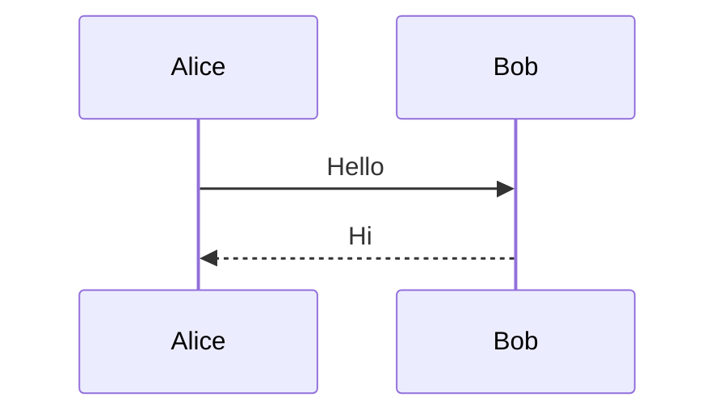

Inline $a^2 + b^2 = c^2$ and $\frac{1}{2}$ in a sentence.

$$
\int_0^1 x^2 \, dx = \frac{1}{3}
$$

$$
\begin{aligned}
a &= b + c \\
d &= e
\end{aligned}
$$



```mermaid
graph TD
  A -->
```

> [!example] A diagram in a callout
> ```mermaid
> graph LR
>   Mac --> Worker
> ```
