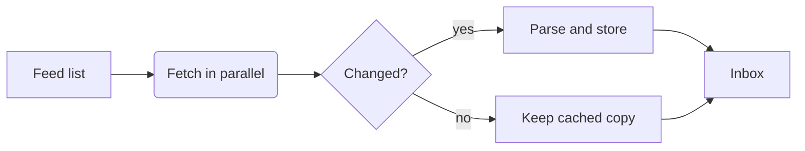

Driftwood is a small, open-source feed reader that keeps everything on your own disk. 0.4 is about **offline reading** and a faster first sync. Ship date: **Friday 20 November**. #driftwood #release

## Milestones

| Milestone             | Owner | Status      | Due    |
| --------------------- | ----- | ----------- | ------ |
| Offline article cache | Ana   | Done        | 30 Oct |
| Parallel feed fetch   | Theo  | In review   | 9 Nov  |
| OPML import           | Wren  | In progress | 13 Nov |
| Release and notes     | Ana   | Not started | 20 Nov |

## How a refresh works

## Before we ship

- [x] Cache articles and images for offline reading
- [x] Respect each feed's ETag and Last-Modified
- [x] Fetch up to eight feeds at once
- [ ] Import subscriptions from OPML
- [ ] Draft the [[Release notes 0.4]]
- [ ] Test on a slow connection
